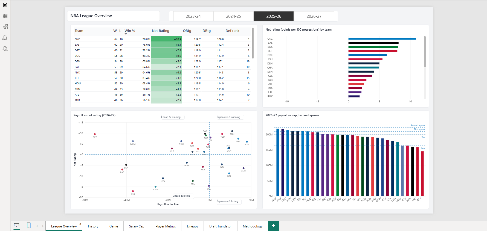
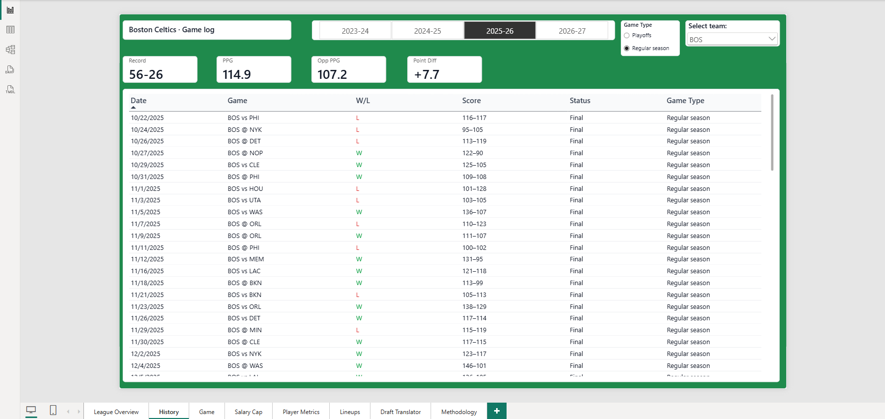
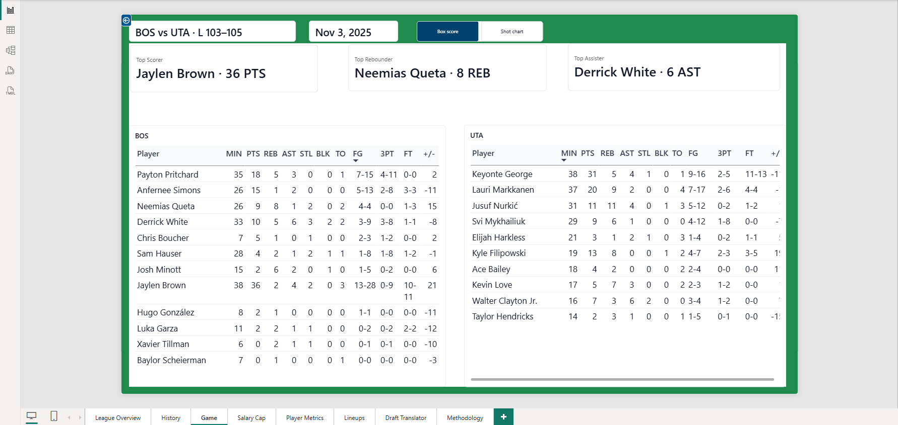
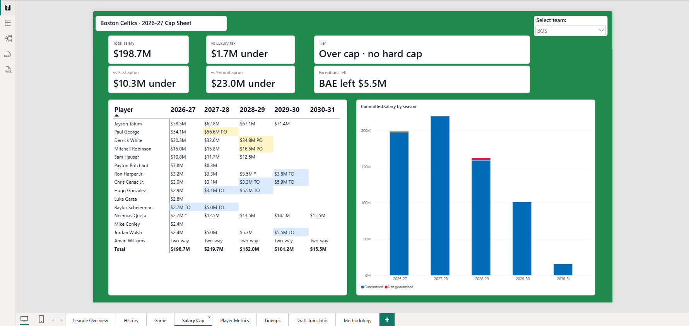
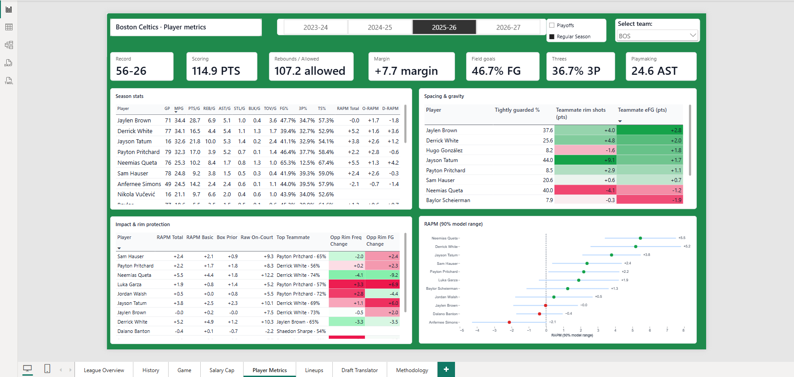
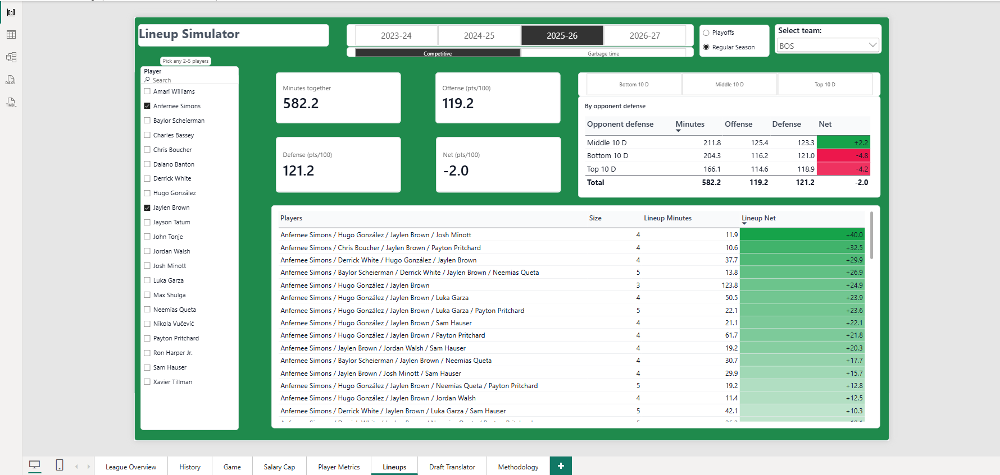
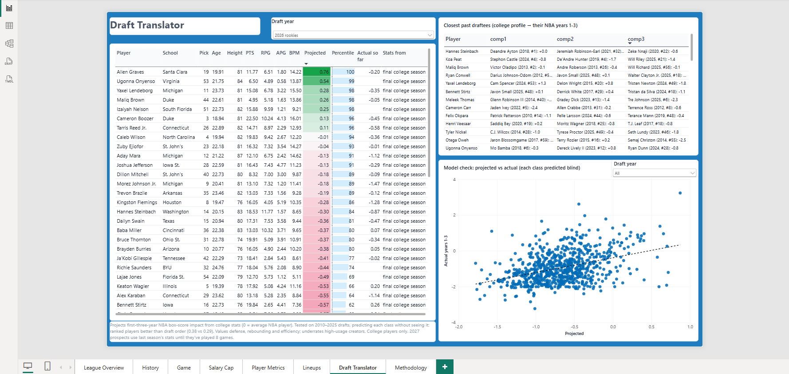

# NBA Front Office Dashboard

A Power BI dashboard built for the questions an NBA front office asks: who's winning and why, what the cap sheet allows, which players actually move the scoreboard, which lineups work, and which draft prospects will translate. It runs on public data refreshed by a one-click Python pipeline.



**Case study:** [$57.7M vs $9.0M on the same roster](case_study.md). Jaylen Brown vs Dean Wade, impact per dollar.

---

## Pages

| Page | Question it answers |
|---|---|
| **League Overview** | Who's good, and who's paying for it? Net rating table, payroll vs net rating quadrant, payroll vs cap/tax/aprons. |
| **History** | How did a team's season go, game by game? Record, scoring margin, full game log with regular season / playoff filter. |
| **Game** | What happened in one game? Box scores for both teams, game leaders, shot chart (dots or heat map). Reached by drill-through from History. |
| **Salary Cap** | What can this team do next summer? 2026-27 cap sheet with player/team options, distance to tax and aprons, exceptions left, hard-cap status. |
| **Player Metrics** | Who actually drives winning? Season stats, RAPM with 90% model ranges, rim protection, and spacing/gravity. |
| **Lineups** | Which combinations work? Pick 2–5 players to see their minutes, offense, defense and net together, split by opponent defense tier. |
| **Draft Translator** | Which prospects will translate? Projects first-three-year NBA impact from college stats, with the closest past draftees and a blind backtest. |
| **Methodology** | How it's built, the data checks that run after every refresh, and known limits. |

| | |
|---|---|
|  |  |
|  |  |
|  |  |

## How it works

```
NBA Stats API ─┐
ShamSports ────┼─> ingest/ (11 scripts) ─> process/ (12 scripts) ─> parquet ─> Power BI
Barttorvik ────┘                                                │
                                                         validate.py (data checks)
```

- **Ingest:** games, box scores, shots, play-by-play, tracking, schedules, draft history, contracts and college stats.
- **Process:** builds stints from play-by-play, fits RAPM, computes on/off, lineup combos, spacing, cap sheets and the draft model.
- **Validate:** contract totals match the source, draftees match their college season, 5-on-5 lineups are complete, 82 games per team, shot rows match box-score FGA, and stint time matches game length.

## Models

**RAPM (player impact).** Ridge regression on every stretch of game with the same 10 players, adjusted for teammates, opponents and home court. Each player is shrunk toward what his box score predicts rather than toward zero. The 90% ranges come from 40 resamples. "RAPM Basic" (no box-score prior) is shown alongside it.

**Draft translator.** Projects first-three-year NBA impact from final-season college stats. It was backtested on 2010–2025 drafts with each class predicted blind, and it ranked players better than draft order did (0.38 vs 0.29 rank correlation).

## Run it

```bat
git clone https://github.com/<pranavsridhar6>/nba-dashboard.git
cd nba-dashboard
python -m venv venv
venv\Scripts\activate
pip install -r requirements.txt
refresh.bat
```

Then open `nba_dashboard.pbix` in Power BI Desktop and click **Home → Refresh**.

## Limits

- Rim protection and spacing are raw on/off numbers, not adjusted for teammates.
- "Tightly guarded %" mixes how much defenses respect a shooter with how well he creates space.
- RAPM and on/off use the regular season only.
- The draft model covers college players only and underrates high-usage creators.
- Hard caps are inferred from exception use.

## Stack

Python (pandas, NumPy, scikit-learn, nba_api) · Parquet · Power BI (DAX, Deneb / Vega-Lite) · Git
